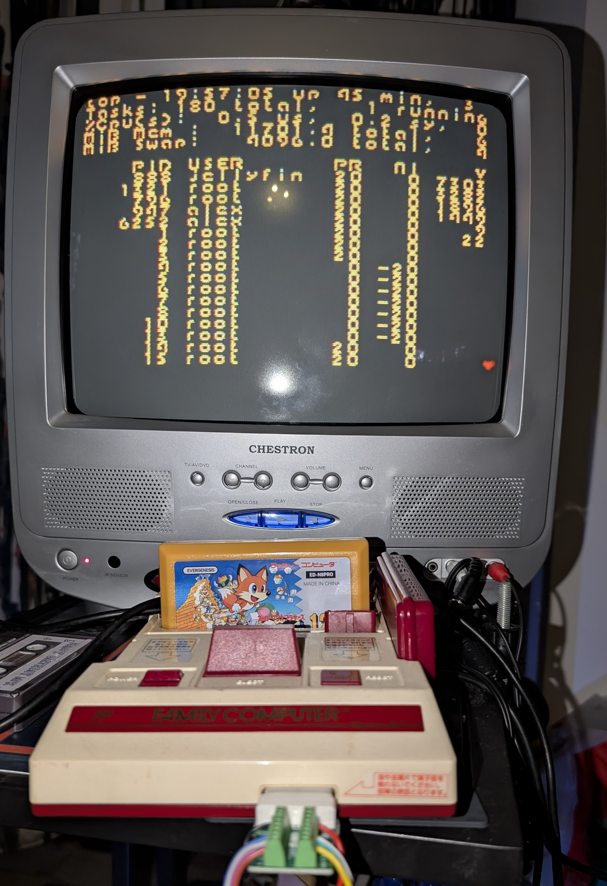
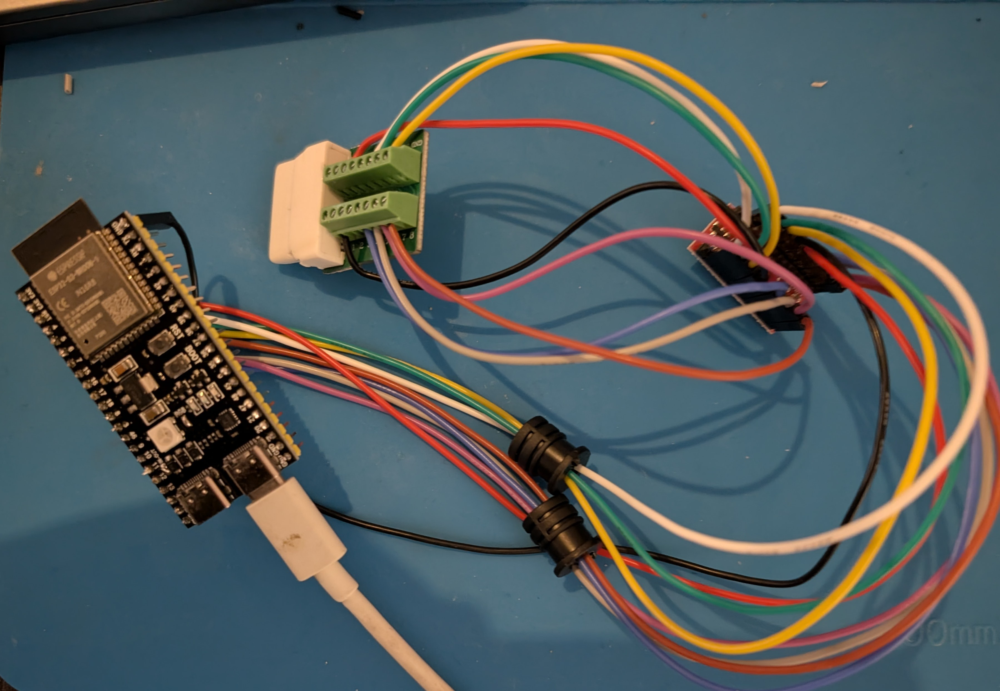
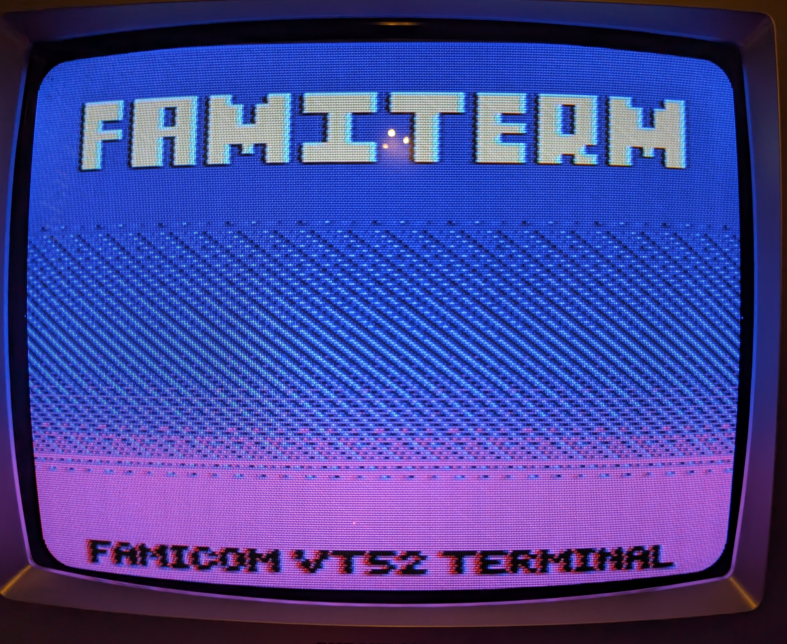
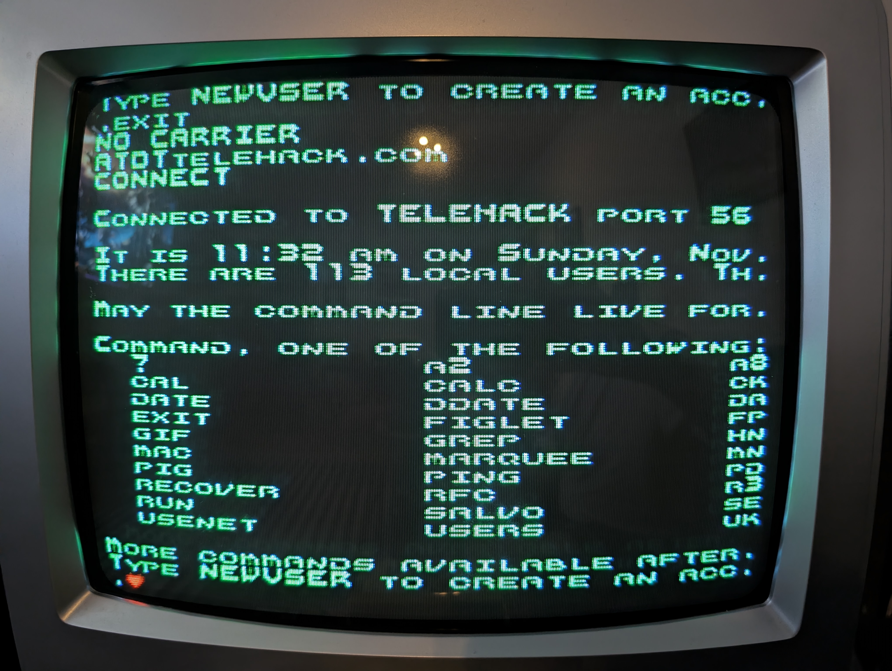
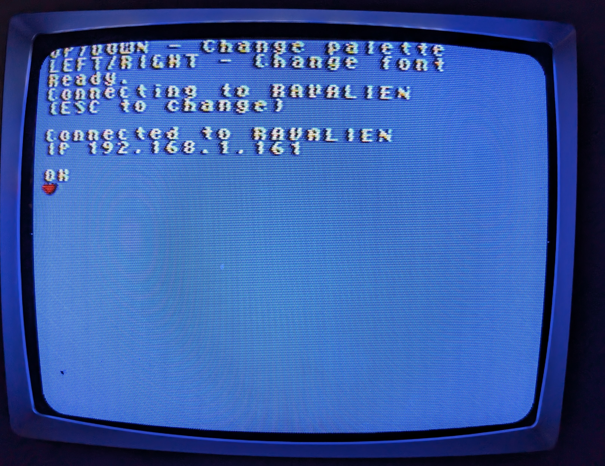

# FamiTerm

<p><strong>A VT52 telnet client and Family BASIC Keyboard emulator.</strong></p>



ESP32-S3 acts as a WiFi modem between a USB keyboard, the network and the Famicom.

```
USB keyboard ──(USB host)──► ESP32-S3 ◄──(UART, framed)──► Famicom peripheral port
                             fami-modem                      $4016 / $4017
          telnet host ◄──(WiFi)──►  │
                                    └──(serial, mirror)──► debug console
```

Typed AT commands drive the modem (`ATDThost:port` dials a telnet host). The modem's echo
and replies, and everything the remote sends, appear on the Famicom and are mirrored to the ESP32-S3's serial port for debugging.

The ROM itself is a mapper 1 (MMC1) cartridge image: 32 KB PRG + 32 KB CHR, built with the
[LLVM-MOS SDK](https://github.com/llvm-mos/llvm-mos-sdk)


## BASIC Keyboard emulator
Hold **ESC** while the ESP32-S3 boots to switch the firmware into Family BASIC keyboard
mode: your USB keyboard then acts as a Famicom Family BASIC keyboard instead of a modem.

## About the terminal

- Accepts an asynchronous byte stream and interprets it as a **VT52** terminal: a 30x28
  monochrome text screen with a 2-screen scrollback ring, a blinking cursor and BEL audio.
- Renders every byte as an **IBM CP437** glyph, so box drawing, shades and symbols from
  typical Linux tools map onto real tiles instead of garbage.
- Lets you change the look from the controller: the D-pad cycles 5 colour palettes and 7
  bitmap fonts, which are all stored in CHR-ROM and banked in on demand.

The keyboard is on the ESP32-S3, so the Famicom only displays what it is sent. The link
has a way back (TERM WRITE, typing from the console), which the ROM does not use yet.

## How it works

The link is a UART on two wires of the expansion port: the Famicom sends on OUT1
(`$4016` bit 1) and receives on P2 D1 (`$4017` bit 1), at 85227 baud, 21 CPU cycles a
bit. The ESP32-S3 runs it on its hardware UART1; the Famicom bit-bangs it with routines
that count cycles, written for the rate by `scripts/gen-link.py`.

Over it go framed requests and replies, after nesp32's link protocol: a marker, a
service, an op or status, a sequence number, a length, the payload and a CRC-16. Once a
frame, right after the NMI, the ROM asks the TERM service for as much of the terminal
stream as it has room for, saying how much it has taken so far. A reply that is lost or
damaged is simply asked for again a frame later, with nothing lost or doubled, and a
console or ESP32-S3 that restarts finds out at its next request and says hello again.

[PROTOCOL.md](PROTOCOL.md) has the wiring and polarity, the frames, the services, the
timing and how it is tested. The protocol's numbers are in one file,
`firmware/link-proto.h`, which the firmware and the ROM both include.

## Requirements

- `make`, `python3`, `curl`, `tar` with xz support (macOS or Linux)
- To run the ROM: [Mesen 2](https://www.mesen.ca) in `/Applications` (or set `MESEN_BIN`)
- For the emulated serial bridge: `brew install socat`

## Setup

The SDK is resolved in this order:

1. `$LLVM_MOS_HOME` (must contain `bin/mos-nes-mmc1-clang`)
2. `./.sdk` in the project
3. `mos-nes-mmc1-clang` on `PATH`

To install the SDK locally into `./.sdk`:

```sh
make nes-sdk    # or ./scripts/setup-nes-sdk.sh
```

To use an existing install instead:

```sh
export LLVM_MOS_HOME=/path/to/llvm-mos
```

The ESP32-S3 side of the bridge, the fami-modem firmware (`firmware/`), is built with its own SDK —
[arduino-cli](https://arduino.github.io/arduino-cli/) plus the `esp32:esp32`
core — installed
into `./.esp32-s3-sdk` so your Arduino IDE install is left alone:

```sh
make sdk-esp32-s3    # or ./scripts/setup-esp32-s3-sdk.sh
```

`make firmware` installs it automatically on first run. To share an existing
install instead, set `ESP32_S3_DATA` (e.g. `make firmware
ESP32_S3_DATA=~/Library/Arduino15`) and `ESP32_S3_CLI`
(e.g. `ESP32_S3_CLI=arduino-cli`).

## Build

```sh
make          # build/nesterm.nes
make romcart  # same: the NES ROM
make build    # ROM + ESP32-S3 firmware
make clean    # remove build/
```

All `romcart/*.c` and `romcart/*.S` files are picked up automatically, with the link's
cycle-timed routines, which `scripts/gen-link.py` writes into `build/gen/`.

### ESP32-S3 firmware

```sh
make firmware            # build/esp32-s3/firmware.ino.bin
make firmware-upload     # build, then flash the connected board
```

```sh
make firmware-upload ESP32_S3_PORT=/dev/cu.usbmodem1420
make firmware ESP32_S3_FQBN=esp32:esp32:esp32s3:USBMode=HWDC   # hardware USB
```

Board and CPU options: `arduino-cli board details -b esp32:esp32:esp32s3`.

`firmware/` is the whole firmware, an arduino-cli sketch (C++): `firmware.ino` has
`setup()`, `famicom-link.*` the Famicom link on UART1, `link-core.*` its protocol (no
Arduino in it, so it is unit-tested on the computer) and `link-proto.h` its numbers,
`usb-keyboard.*` the USB keyboard, `term.*` the modem's terminal (keyboard in, Famicom +
Serial out), and `modem.*` the WiFi modem, ported from David Hansel's
[WiFi modem](https://github.com/dhansel/WifiModem) (GPLv3). It is openable in the Arduino IDE as-is, or you
can flash it with `make firmware-upload`.

## Run

```sh
make run                # Mesen 2 with tools/faketty.lua (serial only)
make test               # Mesen 2 with tools/test.lua (VT52 demo)
make run LUA=           # no Lua script
make run MESEN_BIN=/path/to/Mesen
make check              # the link end to end, headless: see PROTOCOL.md, "Testing"
make bench              # CPU and vblank budget with an endless stream
```

### Virtual serial port (emulator)

`tools/faketty.lua` runs the ESP32-S3 side of the link in Mesen (`tools/esp-link.lua`, a
UART at the level of CPU cycles), polling
`/tmp/ttyEMU.in` (`ESP32_S3_IN`) every frame and delivering new bytes to the ROM as the serial
stream. With `make run` going, in another terminal:

```sh
make bridge                       # creates /tmp/ttyEMU via socat
make run
echo hi > /tmp/ttyEMU
```

`scripts/send-test.sh` types a fake bash session into that file.

### Real hardware

Connect the ESP32-S3 to the Famicom peripheral port through an 8-channel level shifter
(Famicom 5V on the HV side, ESP32-S3 3.3V on the LV side). See PROTOCOL.md for the
GPIO pinout. 



Upload the ROM to a flash cartridge like Everdrive.

Plug a USB keyboard into the ESP32-S3's native **USB** port,
through a USB-C OTG adapter if needed. 
Keep the **UART/COM** port for flashing and the serial log.

The native port must supply 5V to the keyboard, which ESP32-S3-DevKitC-1 boards (and their
two-USB-C clones) don't do out of the box. Bridge both solder jumpers
with solder:

- **USB-OTG**
- **IN-OUT**

On first boot the modem asks for WiFi: press `C`, pick an SSID from the scan and type the
password (stored in flash). Press ESC while it is connecting to change it later. Once it
prints `OK`, use it like a Hayes modem:

```
ATDTbbs.example.com:23    dial a telnet host (default port 23)
+++                       (1s pause either side) back to command mode
ATO / ATH                 return online / hang up
ATE0 ATV0 ATQ1 ATZ ATSn=v echo, verbose, quiet, reset, S-registers
```

Everything shown on the Famicom is also
written to the board's UART port at 115200 baud (e.g.
`arduino-cli monitor -p /dev/cu.usbserial-XXXX -c baudrate=115200`).


## Notes

- Font/CHR order must stay in sync between `FONT_NAMES` in the `Makefile`, `romcart/chr.S`, and
  the `font_names[]` table in `romcart/screen.c`.
- CHR-ROM is capped at 32 KB (splash + 7 fonts): on the old EverDrive N8, MMC1 CHR banks
  past 32 KB read back garbage (`hello/chrtest.nes` checks this).
- Mapper settings (CHR size, mirroring) are set in C via `<ines.h>` macros in `romcart/main.c`;
  horizontal mirroring is required for the scrollback ring.
- AI tools were used in the development of this project.
  

## Screenshots







## Credits

- [WifiModem](https://github.com/dhansel/WifiModem) by David Hansel
- [EspUsbHost](https://github.com/tanakamasayuki/EspUsbHost) by TANAKA Masayuki.
- [Nesp32 link protocol](https://github.com/Armitage64/nesp32) by Armitage64.
- [ZX Origins Fonts](https://damieng.com/typography/zx-origins/) by Damien Guard
